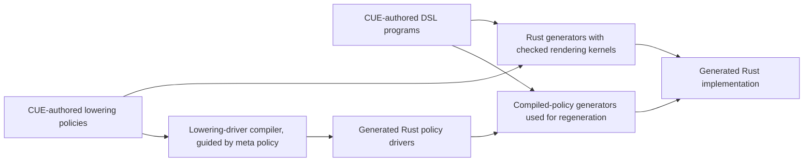
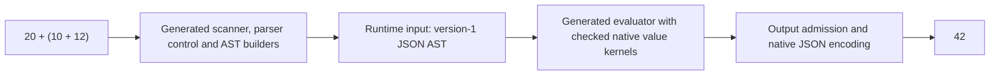
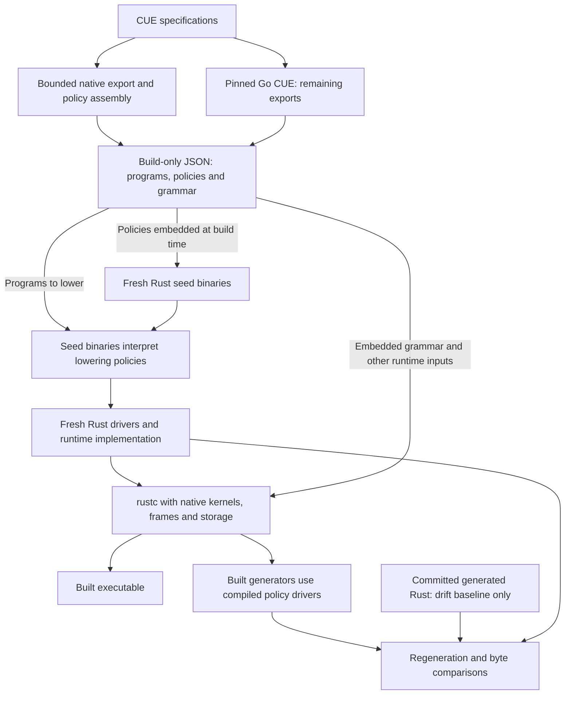

# Architecture: building the implementation, running an expression

Cuestacean aims to express a CUE implementation in a CUE-hosted executable DSL
and compile it to Rust. Today it is a bounded bootstrap, not full CUE. Distinguish
**building the implementation** from **evaluating input with the built executable**.

## Compiler layers



The programs specify scanning, parser control, AST construction, evaluation and
unification. Lowering policies tell the generators how to turn those programs
into Rust. The meta policy guides a compiler that emits the Rust lowering
*drivers* themselves, including its own driver. These arrows show roles and
consumers, not a chain of CUE-to-CUE translations. The generators consume exported
representations; typed decoding, rendering, frames and guards remain Rust.

## Follow one expression



The existing [`nested.cue`](../bootstrap/source/valid/nested.cue) contains
`20 + (10 + 12)`. [`bootstrap-source.rs`](../bootstrap/executor/src/bin/bootstrap-source.rs)
reads it and calls `parser::parse` with embedded, build-exported `grammar.json`.
The parser uses generated scanner, Pratt/primary-control and AST-builder code to
produce a version-1 JSON AST: an outer `add` with integer `20` and an inner `add`
of integers `10` and `12`; parentheses affect grouping, not a separate AST node.
The CLI serializes that AST with `serde_json::to_string` and passes it to
`generated::execute_json`. The already compiled evaluator visits the children,
computes `10 + 12`, then `20 + 22`, and sends the resulting integer through
CUE-authored output-admission policy and native JSON encoding. The CLI prints
`42` and a newline. **It does not compile this expression to Rust**, and it does
not invoke Go CUE at runtime.

## Two paths, two kinds of JSON



At build time, native and Go export paths supply the programs, policies and
grammar. Compiler constructors embed policy data; the joined binaries then
lower the exported programs into Rust. After compilation, the built generators
regenerate code with compiled policy drivers, and the checks compare the
results with fresh seed output and committed goldens. Neither kind of comparison
feeds those goldens into seed construction.

Specification JSON describes how the implementation behaves; input AST JSON
represents the expression being evaluated. Neither is a request to compile each
user expression. Go CUE genuinely evaluates the specification language during
export: resolving definitions, defaults, `let` bindings and comprehensions is not
just packaging inert configuration. But an exported `{op: "sum", ...}` is **data
representing a DSL instruction**, not Go CUE executing a user's addition.

## A small executable rule

The `add` rule in [`evaluation.cue`](../bootstrap/evaluation.cue) has this result:

```cue
{
    op: "sum"
    left:  {op: "evaluate", field: "left"}
    right: {op: "evaluate", field: "right"}
}
```

The reference rule interpreter in `bootstrap/executor/src/lib.rs` evaluates the
left child, then the right, and calls `runtime::sum`. For generated execution,
[`lowering-fragments.cue`](../bootstrap/lowering-fragments.cue) selects
`sum: {op: "call", path: "runtime::sum", args: [L, R]}`; `L` and `R` recursively
lower the corresponding instructions with Result propagation. Its `evaluate`
case emits recursive evaluator calls on AST fields. The resulting
[`evaluation.rs`](../bootstrap/generated/evaluation.rs) contains an `"add"` arm
calling `runtime::sum` on those two evaluated children. This builds a reusable
AST evaluator, not Rust specialized to the numbers in `nested.cue`.

`runtime::sum` delegates to code generated from [`sum.cue`](../bootstrap/sum.cue):
concrete integers select checked native addition, concrete texts select
concatenation, and incompatible/abstract operands fail. Thus the rule traversal,
compiler lowering and value-domain policy are distinct executable layers. The build
exports their programs as JSON; Rust executes their meaning. See the [lowering](../bootstrap/lowering.md)
and [addition](../bootstrap/sum.md) contracts for the exact interfaces.

## What still lives where?

- **Go CUE** evaluates the other specification closures and remains a separate
  test oracle. The [complete AST builder family](native-builder-family.md) now has
  an independently native export path used by the production JSON bundle.
  Export inputs do not depend on compiler seeds or committed artifacts.
- **Shared lowering machinery** interprets CUE-authored policies in fresh seeds;
  default production generators use compiled policy drivers. The AST, scanner,
  Pratt, unification and meta backends share checked rendering machinery. The
  meta policy emits complete drivers, including its own source regeneration.
- **Native Rust** still supplies typed decoding/validation, metadata projection,
  checked arithmetic/value/JSON kernels, storage, grammar lookup, cursor/frame
  protocols and resource guards. Generated code chooses supported policy and
  sequencing; native glue is substantial, not an OS shim or full self-hosting.
- **Generated artifacts** are rebuilt by the graph in
  [`infra/tooling/flake.nix`](../infra/tooling/flake.nix). `clearArtifacts` removes
  staged JSON/Rust before regeneration. `codegenSeed` joins compiler binaries that
  do not use committed generated artifacts as inputs. Standalone constructors use
  narrower policy inputs; see the [checkpoint](bootstrap-status.md) for the current
  split between standalone and bundle-backed construction. In particular, scanner
  source-feature verification still uses Go-exported PROGRAM data; that is separate
  from constructing the scanner compiler. `executor` regenerates Rust before
  compiling and testing the final package.

## Current boundary and where to read next

Production supports abstract scalars such as `_`, `int`, `bool`, `string` and
integer bounds in intermediate unification, alongside bounded concrete values
and closed collections. Arithmetic is eager and requires concrete operands;
output must be concrete. General references, open-struct constraints, defaults
and cycle solving are **not production capabilities**. The [solver spike](solver-spike.md)
is an isolated test-only graph experiment, not a hidden production fallback.
Full bootstrap closure remains unproven. The [performance baseline](performance-baseline.md)
measures only supported CLI cases and selected build targets.

A future graph solver could resolve dependencies and suspended constraints, then
hand ready computations to the eager evaluator. That interface is not established
production architecture; an evaluation error must never trigger a graph fallback.

For scope and counters, start with the [checkpoint](bootstrap-status.md),
[source profile](../bootstrap/source/README.md) and [DSL/native boundary audit](dsl-boundaries.md).
The [closure inventory](bootstrap-closure.md) traces the remaining Go CUE cut;
[output admission](../bootstrap/output-control.md) separates policy from encoding.
The [generation runbook](../bootstrap/generated/README.md) and
[tooling guide](../infra/tooling/README.md) retain detailed regeneration/validation steps.

## Try it with pinned tooling

From this checkout's root, use an explicit workspace source path:

```sh
nix run "path:$PWD?dir=infra/tooling#source" -- bootstrap/source/valid/nested.cue
nix develop "path:$PWD?dir=infra/tooling" --command cargo test \
  --manifest-path bootstrap/executor/Cargo.toml \
  --test parser --test codegen --test sum_control --test output_control
```

On x86_64-linux, these runs printed `42` and passed all 26 focused tests. The
complete Rust suite, strict Clippy and pinned preflight passed (13/13, 7 inapplicable
checks skipped); the declared Nix checks were exercised in actual sandboxes. Other
architectures were not validated. See the [checkpoint runbook](bootstrap-status.md#build-and-validation-runbook).
